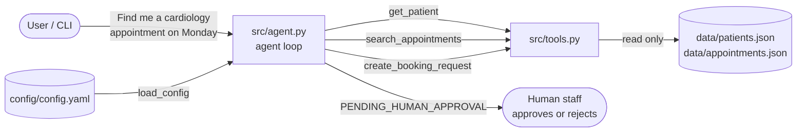
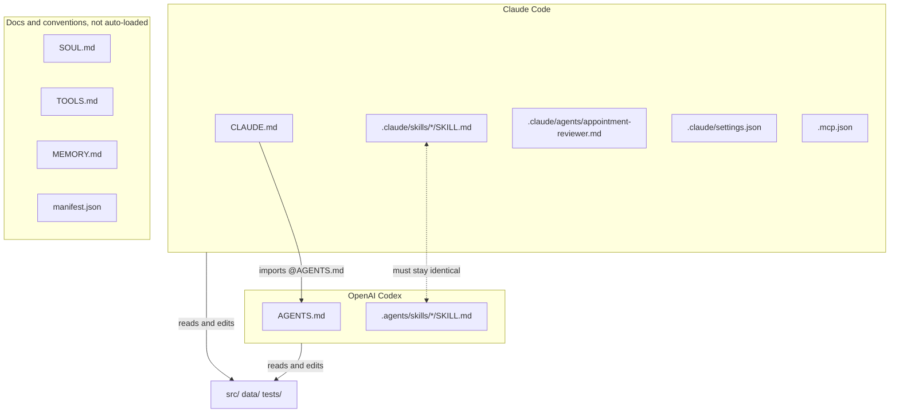

# Architecture

## 1. The Python demo at runtime

The loop has five steps: **understand, search, show, recommend and prepare, stop for a human.**
In a real AI agent, an LLM would perform step 1 ("understand") and decide which tool
to call. Here, keyword matching does it, so the run is the same every time.

## 2. How coding agents use the Markdown and config files

## 3. Key distinctions

### Instructions vs. executable code
- **Instructions** (`AGENTS.md`, `CLAUDE.md`, `SKILL.md`) are natural-language text that an
  LLM *reads and tries to follow*. The model may still make mistakes.
- **Executable code** (`agent.py`, `tools.py`) runs exactly as written.
- That is why the "never confirm a booking" rule appears in **both** places: the instructions
  guide the AI, and the code plus tests *enforce* the rule.

### Skills vs. tools
- A **tool** is an *action* the agent can perform, such as a function call
  (`search_appointments`). It does one thing and returns data.
- A **skill** is a *procedure*, a recipe written in Markdown that tells the agent **which
  tools to use, in what order, and with what rules**. It is loaded only when relevant.
- In short: tools are verbs, and skills are playbooks.

### Memory vs. context
- **Context** is everything in the model's input *right now*: system prompt, loaded files,
  conversation, and tool results. It disappears when the session ends.
- **Memory** is information *saved outside* the model (such as `MEMORY.md`) and *loaded
  back into context* in a later session. Without code that saves and loads it, a file
  named `MEMORY.md` is just a document.

### MCP configuration vs. a working MCP server
- `.mcp.json` only says **how to start** a server (command, arguments, environment).
- A **working MCP server** is a separate program that implements the Model Context Protocol
  and exposes tools. This repository's `.mcp.json` points to
  `placeholder_mcp_server_NOT_IMPLEMENTED`, so Claude Code would fail to start it. The
  config file alone does nothing.

### Agent configuration vs. actual agent execution
- **Configuration** (`config.yaml`, `settings.json`, `manifest.json`) *describes* settings
  and limits.
- **Execution** is a running program that reads the configuration and acts on it. For
  example, `max_results: 3` matters only because `agent.py` reads it and passes it to
  `search_appointments`. Similarly, `manifest.json` lists capabilities, but nothing reads it,
  so it changes nothing.
